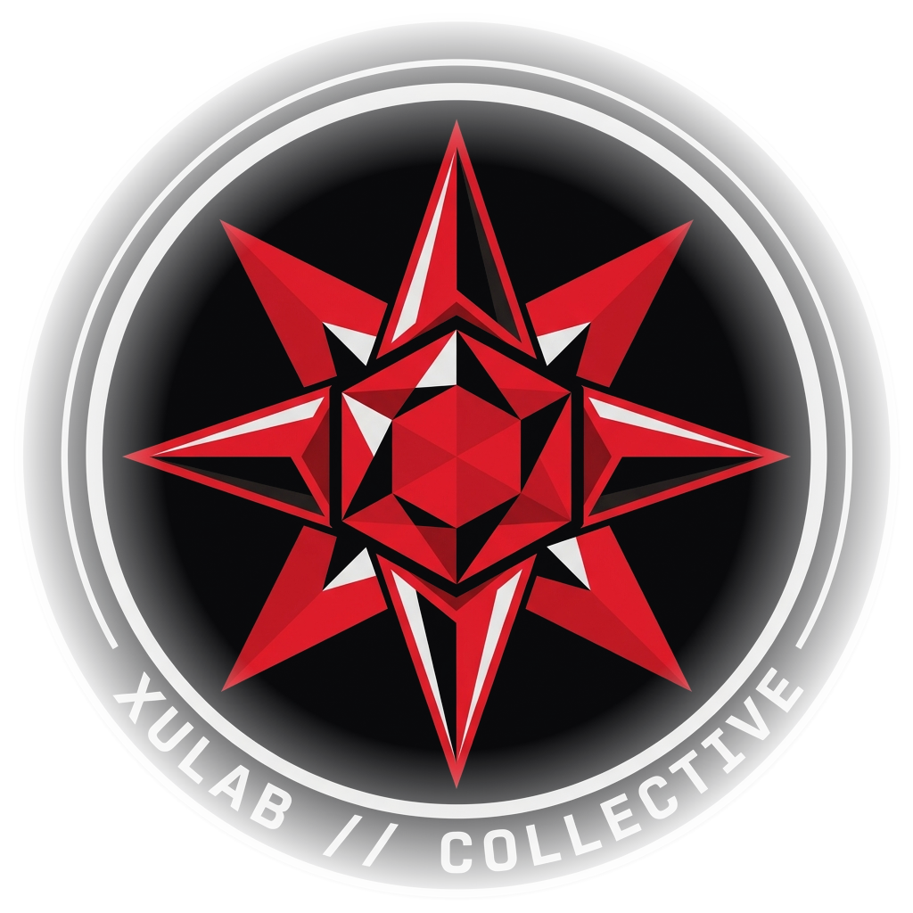
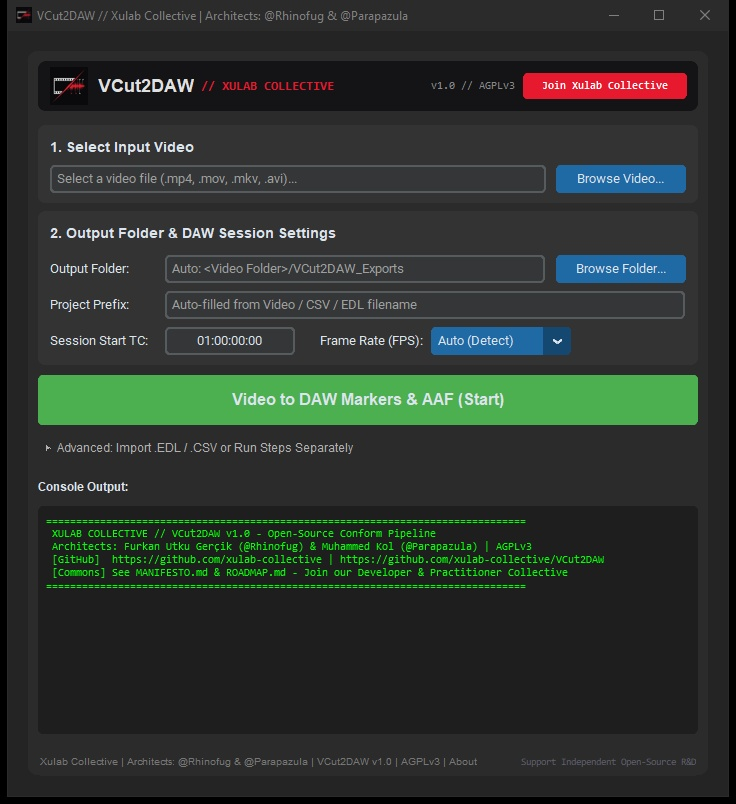

<p align="center">
 
</p>

# VCut2DAW // Xulab Collective
### Open-Source Video-to-DAW Conform & Scene Marker Pipeline

```text
X U L A B   C O L L E C T I V E  //  V C u t 2 D A W
[ ARCHITECTS: @Rhinofug & @Parapazula  |  COMPUTE: 100% LOCAL  |  LICENSE: GNU AGPLv3 ]
```

> **For digital workers, against exploitative closed software and capital monopolies:** An open-source post-production pipeline tool forged by **[Xulab Collective](MANIFESTO.md)** to eliminate mechanical conform drudgery and reclaim time for Sound Editors, Dialogue Editors, Re-Recording Mixers, and Assistant Editors.

**VCut2DAW** runs 100% locally on your own silicon. It automatically detects visual cuts from any video file or parses CMX3600 `.edl` timelines and generates **strictly compliant Pro Tools / DAW Dummy AAFs and Frame-Accurate MIDI Markers** in one click to collapse hours of manual scene spotting into seconds.



---

## Join Xulab Collective

**VCut2DAW** is the first open-source instrument released from the **Xulab Collective** R&D foundry. Read our **[Manifesto](MANIFESTO.md)** and connect with our engineering and post-production network:

- **[Xulab Web Portal // TR & EN](https://xulab-collective.github.io)** // *Read the Manifesto and download standalone builds directly.*
- **[Xulab Manifesto // TR & EN](MANIFESTO.md)** // *Why we collectivize the means of post-production.*
- **[Xulab Rulebook & Protocol](PROTOCOL.md)** // *How 100% Free Open-Source projects and Profit-Sharing Commercial `Dual-License` projects operate under Xulab.*
- **[Commercial & Profit-Pool Policy](COMMERCIAL_POLICY.md)** // *Transparent `Slicing Pie` point model and commercial revenue-sharing standards.*
- **[R&D Roadmap & Master Plan](ROADMAP.md)** // *Continuous QA and Education tracks plus 3-Phase Strategic Plan: Open-source AI-integrated tools, Collective AI Weights on local silicon, and Autonomous Practitioner Squads.*
- **Xulab Discord:** **[https://discord.gg/ZCFHD5qHgJ](https://discord.gg/ZCFHD5qHgJ)** // *Central Hub, Working Groups, and Peer Collaboration*
- **Telegram Channel:** **[https://t.me/xulabcollective](https://t.me/xulabcollective)**
- **YouTube Channel:** **[https://www.youtube.com/@xulab-collective](https://www.youtube.com/@xulab-collective)**
- **Xulab GitHub Org:** **[github.com/xulab-collective](https://github.com/xulab-collective)** · **Founding Architect:** **[@Rhinofug](https://github.com/rhinofug)** · **Co-Architect:** **[@Parapazula](https://github.com/Parapazula)**

---

## Installation & Important macOS Notes

### Option 1: Download Pre-built Standalone App // Recommended
Go to the **[v1.0.2 Release Page](https://github.com/xulab-collective/VCut2DAW/releases/tag/v1.0.2)** and download the latest Windows `.exe` or macOS `.dmg`. Zero cloud accounts, zero telemetry, 100% offline execution.

> **Which Mac DMG do I need?**
> - **M1 / M2 / M3 / M4 Mac** → download `VCut2DAW_AppleSilicon.dmg`
> - **Older Mac with an Intel chip** → download `VCut2DAW_Intel.dmg`
> - **Not sure?** Click the Apple menu → **About This Mac** and look at "Chip" or "Processor". The Intel DMG also runs on Apple Silicon through Rosetta.

> **IMPORTANT macOS GATEKEEPER NOTE:**  
> Because this binary is distributed directly to practitioners without paying Apple's annual corporate developer tax, macOS Gatekeeper quarantines it when downloaded from a browser, showing an *"App is damaged"* or *"Cannot be verified"* alert.  
> **To clear the quarantine flag in 5 seconds:**
> 1. Open the `.dmg` and drag `VCut2DAW` into your **Applications** folder.
> 2. Open the **Terminal** app on your Mac.
> 3. Run: `xattr -cr /Applications/VCut2DAW.app`
> 4. Launch the app normally.

### Option 2: Compile from Source // 100% Auditable

**For Windows:**  
Double-click `compile_windows.bat`. It automatically sets up a local virtual environment, installs dependencies, compiles the source code into a standalone `.exe`, and outputs it to `builds/VCut2DAW.exe`.

**For macOS / Linux:**  
Open your terminal in the repository folder and run:
```bash
chmod +x compile_mac.sh
./compile_mac.sh
```

---

## Why We Built This & The Technical Edge

> **Architect's Note // `@Rhinofug`:**  
> The core building blocks required for visual cut detection and DAW timeline generation such as `PySceneDetect`, `pyaaf2`, and `Mido` already exist in the open-source commons. Keeping already-existing open libraries behind paywalls instead of giving them directly to working practitioners felt completely unnecessary to me. **I built VCut2DAW from the ground up in two days using open protocols and released it for free to the commons.**  
>  
> **This is our first shared instrument, built to empower our peers against exploitative closed software monopolies and prove that we can build our own self-sufficient open-source R&D network.**

Legacy post-production workflows waste thousands of practitioner hours on broken interchange formats. **VCut2DAW** solves four critical engineering bottlenecks:

- **DAW AAF Strictness // Pro Tools & Nuendo:** Pro Tools 12.5+ aggressively rejects standard OTIO AAFs. VCut2DAW uses `pyaaf2` to construct strictly compliant `SourceMob`, `MasterMob`, and `CompositionMob` hierarchies with valid `PCMDescriptor` blocks so DAWs never throw an import error.
- **Fractional Frame Rate & Sample-Accurate Sync // `23.976` / `29.97` / `59.94`:** Non-integer NTSC framerates leave fractional audio samples on every frame, such as `1601.6` samples per frame at 29.97 fps and 48 kHz. VCut2DAW uses exact broadcast rational ratios `24000/1001`, `30000/1001`, and `60000/1001` plus absolute sample and tick accumulation at 48 kHz so cuts never drift across 160-minute broadcast episodes or feature reels.
- **The 1-Frame Drift Fix:** Automated cut detection often places the cut on the first *new* frame, causing a 1-frame offset compared to picture department NLE edits. PySceneDetect CSVs number frames starting at 1; VCut2DAW normalizes all detected cuts to 0-based frames and locks timeline gaps with AAF `Filler` objects for exact frame sync. CMX3600 EDL cuts are already exact NLE frame numbers and are preserved without shifting.
- **The 120 BPM MIDI Sync Fix:** DAWs like Pro Tools tie imported MIDI marker positions to the session tempo map. VCut2DAW writes a Standard MIDI File Type 1 at Pro Tools' native `960 PPQ` with a locked `120 BPM` tempo at `1920 ticks/sec`, ensuring a `01:00:00:00` timecode offset lands at exactly 1 hour without 32-bit tick overflow. Track 0 is the Conductor Track with tempo, time signature, and global ruler markers, and Track 1 carries playable Track Markers plus 1-frame note blips.

## Core Capabilities
- **One-Click Video-to-DAW Pipeline:** Select an `.mp4`, `.mov`, `.mkv`, or `.avi` video and generate frame-accurate CSV scene lists, MIDI Markers, and a Pro Tools Dummy AAF Clip Track in one run.
- **Auto & Manual Frame Rate Control:** Automatically detects video framerate across `23.976`, `24`, `25`, `29.97`, `30`, `50`, `59.94`, and `60` FPS, or allows manual override for EDLs.
- **Direct CMX3600 `.EDL` & `.CSV` Ingestion:** Open the collapsible **Advanced** panel and convert `.edl` or `.csv` files directly into AAF & MIDI.
- **Dummy AAF Clip Track:** Generates an empty clip boundary track so you can use `Tab to Transient` / `Tab to Clip Boundary` to snap your playhead across visual scene cuts instantly.
- **Structured `VCut2DAW_Exports` Output:** Automatically creates a clean `VCut2DAW_Exports/` directory next to your source video with `CSV/`, `MIDI/`, and `AAF/` subfolders.
- **Session Start Timecode Offset:** Enter your reel or episode start timecode such as `01:00:00:00` for zero-math spotting.

---

## System Requirements & DAW Compatibility

| Platform / DAW | Supported Versions & Details |
| :--- | :--- |
| **Pro Tools // Studio, Ultimate & HD** | **Pro Tools 10, 11, 12.5 through Pro Tools 2025.12+**<br>• **PT 2022.9 – 2025.12+:** Full support for Global Ruler Markers up to 32,000, Track Markers on 2023.6+, and Dummy AAF Clip Tracks.<br>• **PT 10 / 11 / 12.5 – 2022.7:** Full Dummy AAF Clip Track support with unlimited cuts plus MIDI Markers up to Pro Tools' legacy 999 Memory Locations limit. |
| **Pro Tools Intro / First** | MIDI Markers supported; AAF import is disabled by Avid in free Intro/First editions. |
| **Other DAWs** | **Nuendo, Cubase, Logic Pro, Reaper, Studio One, DaVinci Resolve Fairlight** via standard SMF Type 1 MIDI & AAF. |
| **Windows** | **Windows 10 & Windows 11 64-bit**. |
| **macOS** | **macOS 11 Big Sur through macOS 15 Sequoia+** with native **Apple Silicon M1 / M2 / M3 / M4** `.dmg` and **Intel x64** `.dmg` builds. |

---

## Practitioner FAQ // Pro Tools & DAW Tips

**1. "My MIDI markers don't line up with the video!" // The 120 BPM Rule**  
DAWs like Pro Tools bind MIDI marker timecodes to the session's tempo map. **Your DAW session tempo MUST be set to 120 BPM** when importing the MIDI file. At 120 BPM, every marker is 100% frame-accurate.

**2. Session Start Timecode Mismatch**  
The `Session Start Timecode` entered in VCut2DAW such as `01:00:00:00` **must match** your DAW's Session Start Time. If VCut2DAW is set to `01:00:00:00` while your Pro Tools session starts at `00:00:00:00`, markers will spot 1 hour late.

**3. Why is the AAF Audio Offline / Empty?**  
**By design.** VCut2DAW generates a lightweight "Dummy" AAF track without bulky audio media. Its purpose is to place frame-accurate clip boundaries on your timeline so you can use `Tab to Transient` to jump between visual cuts at zero disk cost.

**4. Why are some subtle visual cuts missed during automated video detection? // Open R&D Call for Contributors**  
When analyzing raw video files rather than importing a frame-exact `.edl` from the picture editor, `VCut2DAW` relies on the upstream Python computer-vision library `PySceneDetect`. Standard CV detection heuristics can occasionally miss subtle post-production cuts such as dark-on-dark cuts, low-contrast match cuts, whip-pans, or fast dissolves.  
- **Open Engineering Challenge for Incoming Contributors:** Fine-tuning the Python cut-detection architecture specifically for cinema and broadcast post-production through custom HSV/Luma histogram weighting, adaptive windowing, and local optical/neural cut verification is intentionally left open as the **first collaborative R&D mission** for developers joining **Xulab Collective**.

---

## License // `GNU AGPLv3` & Further Development

This software is forged by **Xulab Collective** and licensed under the **[GNU Affero General Public License v3.0 // AGPLv3](LICENSE)** with **Dual-License** protection against closed-source corporate enclosure; see **[PROTOCOL.md](PROTOCOL.md)**.

- You are free to run, study, share, and modify this software on your own hardware for any personal, cooperative, or production workflow.
- Any derivative work, modified binary, or network/cloud service built from this code must remain 100% open-source under the **GNU AGPLv3**, ensuring that tools built for the commons can never be enclosed into proprietary corporate products or SaaS wrappers.
- **Current Repo Scope & Further Development:** The primary ongoing need for `VCut2DAW` is **debugging, platform/DAW edge-case testing, and issue cleaning**. Developers who wish to build **further expansions or new features** on top of `VCut2DAW` may either **fork the repository without breaking the `AGPLv3` license**, or **join the Xulab Producer Council** under our **[Rulebook // PROTOCOL.md](PROTOCOL.md)**.

---

## Collective & Credits

**Collective:** **[Xulab Collective](https://github.com/xulab-collective)** // *[Manifesto](MANIFESTO.md)* · *[Governance](PROTOCOL.md)* · *[Roadmap](ROADMAP.md)*  
**Founding Architect:** **Furkan Utku Gerçik // [@Rhinofug](https://github.com/rhinofug)** · [rhinofug.github.io](https://rhinofug.github.io) · [X // @Rhinofug](https://x.com/Rhinofug)  
**Co-Architect:** **Muhammed Kol // [@Parapazula](https://github.com/Parapazula)**  
**Early Practitioner Testers:** Çağlar "Çakan" Çakmak, Can Doğduaslan, Ömür Öztürk, Çağdaş Yarman

### Open-Source Engines Powering VCut2DAW
We stand in solidarity with the open-source developers whose libraries made this pipeline possible:
- **[PySceneDetect](https://github.com/Breakthrough/PySceneDetect) // by bcastillox:** Frame analysis and adaptive cut detection engine.
- **[pyaaf2](https://github.com/markreidvfx/pyaaf2) // by markreidvfx:** Pure-Python AAF reading and writing library.
- **[Mido](https://github.com/mido/mido):** MIDI message and SMF Type 1 structure generation.
- **[CustomTkinter](https://github.com/TomSchimansky/CustomTkinter) // by TomSchimansky:** Cross-platform dark-mode desktop GUI framework.

---
**This is our first shared instrument, built to empower our peers against exploitative closed software monopolies and prove that we can build our own self-sufficient open-source R&D network.**

*Forged by **Xulab Collective** & **@Rhinofug**. Collectivizing the means of post-production.*  
*[Support Independent Open-Source R&D](https://buymeacoffee.com/rhinofug)*
